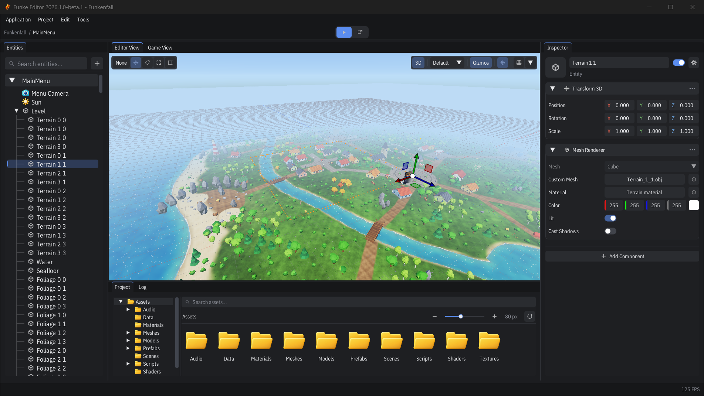
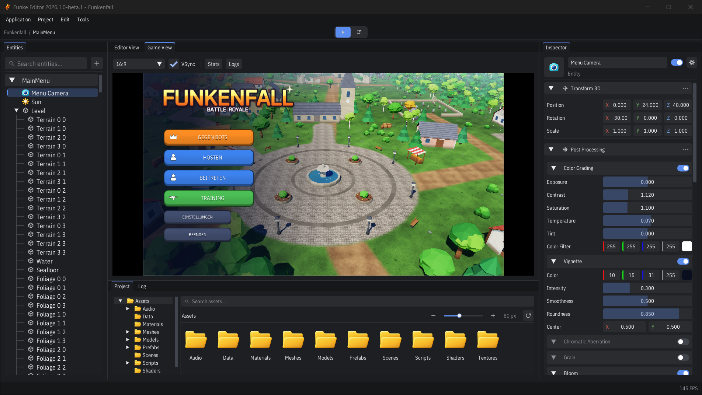
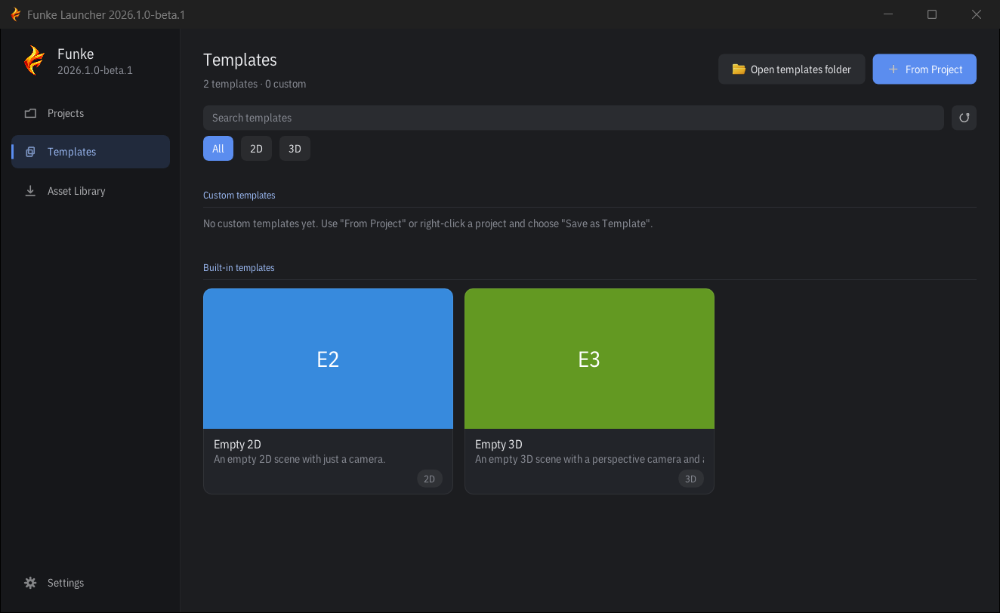
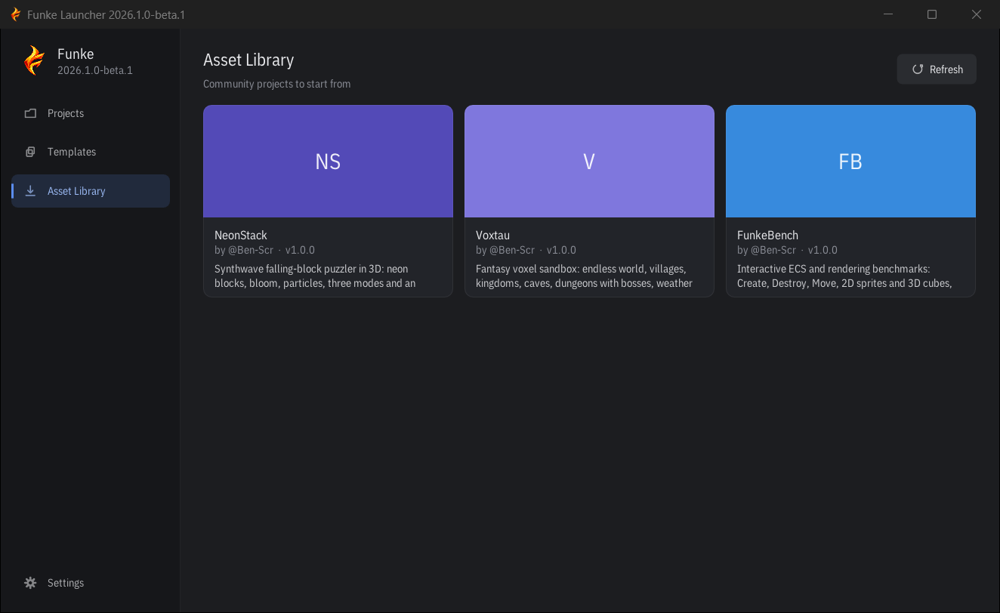

<p align="left">
 
<p align="left">

Funke is a lightweight, modular game engine with **C++ and C# support** for game development, focused on performance and supporting both 2D and 3D projects. The native engine is implemented in C++20; game logic and packages can be written in C++, C#, or a combination of both.

> **Beta.** The editor and launcher run on **Windows x64**, **Linux x64** and **macOS** (Apple Silicon and Intel), and each exports games for its own desktop platform. Android, iOS and Web exports come from platform packages. See [Known Limitations](Github-Docs/Documentation/Known-Limitations.md).

**Making a game?** Download the installer for Windows x64, Linux x64 or macOS Apple Silicon from [Releases](https://github.com/Ben-Scr/Funke/releases) and follow **[Your First Game](Github-Docs/Documentation/Getting-Started.md)**. Windows setup includes the .NET 10 SDK prerequisite; on Linux and macOS, install the [.NET 10 SDK](https://dotnet.microsoft.com/download/dotnet/10.0) separately. You do not need to clone the engine repository for ordinary C# projects. See [Desktop installers](installer/README.md) for requirements.

**License:** Funke is free and open source under the [MIT License](LICENSE.txt). Use it for any project, commercial or not; just keep the license notice with copies of the engine (game builds already include it in their `Licenses` folder).

## Develop with C++ and C#

- **C#:** write game logic with `EntityScript`, `SceneSystem` and `GlobalSystem`, Inspector integration and hot reload. Start with [Your First Game](Github-Docs/Documentation/Getting-Started.md) and the [scripting guide](Github-Docs/Documentation/Scripting/Scripting.md).
- **C++:** create native scripts in the editor with `NativeScript`, Inspector integration and native rebuild/reload, or build an application directly with the native SDK. See [Native C++ scripts](Github-Docs/Documentation/Scripting/Scripting.md#native-c-scripts) and the [C++ application/SDK guide](Funke-Engine/README.md).
- **Combine both:** use C++ and C# scripts in the same project and author [packages with native and/or managed layers](Github-Docs/Documentation/Packages/Writing-Packages.md). The languages have distinct APIs and build requirements; follow the guide for your chosen workflow.

## Packages and reference games

Funke's available features span the engine and separately distributed packages. This repository's built-in components and empty project templates are not the full catalog.

- **Tilemaps** are available through [Funke.Tilemap2D](https://github.com/Ben-Scr/Funke-PackageRegistry/tree/main/packages/Funke.Tilemap2D).
- **Input actions, control maps and saved rebinding** are available through [Funke.Input](https://github.com/Ben-Scr/Funke-PackageRegistry/tree/main/packages/Funke.Input).
- Install optional packages through the editor's **Package Manager**; see the [package overview](Github-Docs/Documentation/README.md#packages) for discovery and installation.
- **Reference games already exist:** open the Launcher's **Asset Library** to download projects such as **NeonStack** and **Voxtau**, or the **FunkeBench** sample. They are distributed through the separate [Funke Asset Library](https://github.com/Ben-Scr/Funke-AssetLibrary), not the engine repository's `templates/` folder.

Check the package documentation and Asset Library alongside [Known Limitations](Github-Docs/Documentation/Known-Limitations.md) when evaluating Funke's capabilities. A feature supplied by an optional package is available in Funke even when it is not built into the core.

## Preview Images

### Editor

<p align="center">
  
  
</p>

### Launcher

<p align="center">
  
  
</p>

## Getting Started

Clone with submodules:

```bash
git clone --recurse-submodules https://github.com/Ben-Scr/Index.git Funke
cd Funke
```

Then follow the steps for your platform. Re-run setup when dependencies or submodules change. For ordinary development, use the incremental commands in [Contributing](CONTRIBUTING.md); changing existing source files does not require setup again.

<details>
<summary><b>Windows (MSVC v143 / Visual Studio 2022 toolchain)</b></summary>

**Prerequisites:** Visual Studio 2022 (MSVC v143 toolset + Windows SDK), .NET 10 SDK, Python 3.10+, Git, and CMake. Opening Funke's `net10.0` game projects in Visual Studio requires Visual Studio 2026 (18.0+) even though the native build continues to use the VS2022/v143 toolchain.

After a fresh clone, fetch and build the git-ignored Dawn/WebGPU dependency once:

```bat
scripts\dawn\SetupDawn.bat
```

Generate the project files:

```bat
scripts\Setup.bat
```

Setup checks every prerequisite and asks `[Y/n]` before installing a missing one via winget: Python, Git, the .NET 10 SDK, CMake, Premake, and (default *no*, several GB) the Visual Studio 2022 Build Tools with the C++ workload. Pass `-y` to accept all, or `--no-install` to only report what is missing.

Build managed projects with the .NET 10 SDK and native projects with the Visual Studio 2022 toolchain:

```powershell
.\scripts\BuildWindows.ps1 -Configuration Release
```

Create and verify the standalone engine bundle:

```powershell
.\scripts\BuildWindows.ps1 -PublishBundle
```

Create the Windows setup with selectable packages, templates and command-line tools:

```powershell
.\scripts\BuildInstaller.ps1 -DownloadCompiler
```

See [Installer development](installer/README.md) for build and signing options, and
[Install Funke on Windows](Github-Docs/Documentation/Editor/Installer.md) for the setup workflow.

See [Building and Shipping](Github-Docs/Documentation/Editor/Building-and-Shipping.md) for game exports, prerequisites, and the clean-machine release checklist.

</details>

<details>
<summary><b>Linux (GNU Make)</b></summary>

**Prerequisites:** a C++20 compiler (GCC or Clang; Dawn's source build needs Clang), GNU Make, CMake, the .NET 10 SDK, Python 3.10+, Git, and the X11 / Wayland development packages SDL3 builds against. Running the editor needs a Vulkan driver (Mesa or the GPU vendor's).

Generate the makefiles:

```bash
chmod +x scripts/Setup.sh
./scripts/Setup.sh
```

Setup asks `[Y/n]` before installing anything missing through apt, dnf, pacman or zypper: Python, Git, the .NET 10 SDK, CMake, and the C++ toolchain with the X11/Wayland/GL development headers. It then builds SDL3 (`scripts/sdl/SetupSDL.py`). Distribution-built .NET SDKs (e.g. Ubuntu's `dotnet-sdk-10.0`) work as well as Microsoft's.

Build Dawn (WebGPU) once, then everything else. `Funke-Managed` builds the C# projects (Funke-ScriptCore, the hot-reload compiler and the package tool) with `dotnet`; the Launcher target also bundles the Editor, Runtime, `funke` tool and EngineSDK next to the Launcher:

```bash
./scripts/dawn/SetupDawn.sh
make config=dist -j"$(nproc)" Funke-Runtime
make config=release -j"$(nproc)" Funke-Launcher
./bin/Release-linux-x86_64/Funke-Launcher/Funke-Launcher
```

`python3 scripts/PackagePosix.py` packs that folder into `Funke-Editor-<version>-Linux-x64.tar.gz`.

</details>

<details>
<summary><b>macOS (Apple Silicon or Intel, GNU Make)</b></summary>

**Prerequisites:** macOS 15 or later, the Xcode Command Line Tools (`xcode-select --install`), CMake, the .NET 10 SDK, Python 3.10+ and Git. Rendering uses Metal through Dawn. See Microsoft's [.NET 10 supported systems](https://github.com/dotnet/core/blob/main/release-notes/10.0/supported-os.md) for the managed runtime's current support policy.

```bash
chmod +x scripts/Setup.sh
./scripts/Setup.sh
```

Setup offers to install missing tools through [Homebrew](https://brew.sh) and opens the Command Line Tools installer when they are missing. The quickest start is `brew install python3 cmake premake make` first. Setup finds versioned Pythons (`python3.13`), installs the .NET SDK into `~/.dotnet` without administrator rights (the Homebrew cask needs them), and replaces a premake that can't run on Apple Silicon with Homebrew's. Then build Dawn once and the rest:

```bash
./scripts/dawn/SetupDawn.sh
make config=dist -j"$(sysctl -n hw.ncpu)" Funke-Runtime
make config=release -j"$(sysctl -n hw.ncpu)" Funke-Launcher
./bin/Release-macosx-arm64/Funke-Launcher/Funke-Launcher
```

On managed Macs where `make` fails with *Permission denied*, use GNU make (`brew install make`) and write `gmake` instead of `make`; the editor then uses `gmake` too. On Intel Macs the folder is `Release-macosx-x86_64`. `python3 scripts/PackagePosix.py` packs it into `Funke-Editor-<version>-macOS-<arch>.tar.gz`.

</details>

## Documentation

Guides for building games with Funke live in **[`Github-Docs/Documentation`](Github-Docs/Documentation/README.md)**.

## Built With

- [WebGPU via Dawn](https://dawn.googlesource.com/dawn) — rendering (picks D3D12 / Vulkan / Metal at runtime)
- [SDL3](https://github.com/libsdl-org/SDL) — windowing, input, gamepads & platform services
- [Box2D](https://github.com/erincatto/box2d) — 2D physics
- [Jolt Physics](https://github.com/jrouwe/JoltPhysics) — 3D physics
- [EnTT](https://github.com/skypjack/entt) — ECS
- [Miniaudio](https://github.com/mackron/miniaudio) — audio
- [GLM](https://github.com/g-truc/glm) / [STB](https://github.com/nothings/stb) — math & image loading
- [.NET 10 LTS / hostfxr](https://dotnet.microsoft.com/) — C# scripting host


